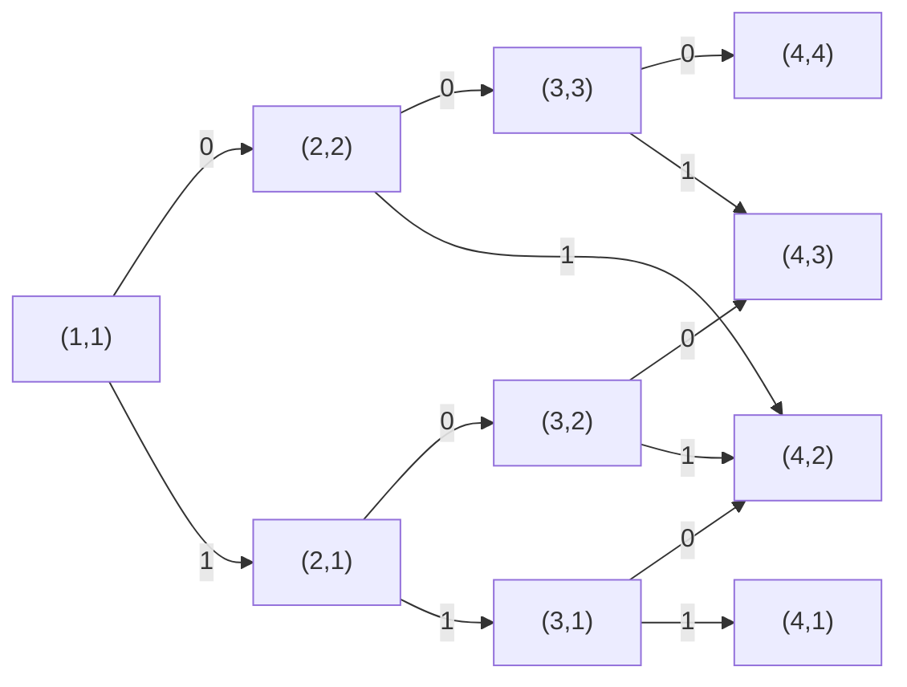
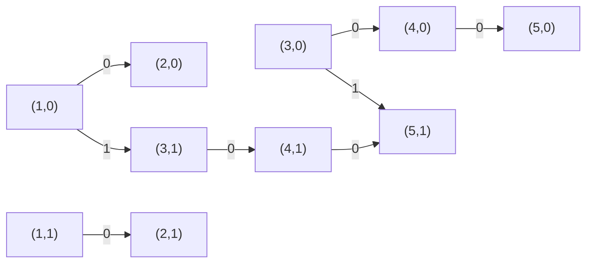
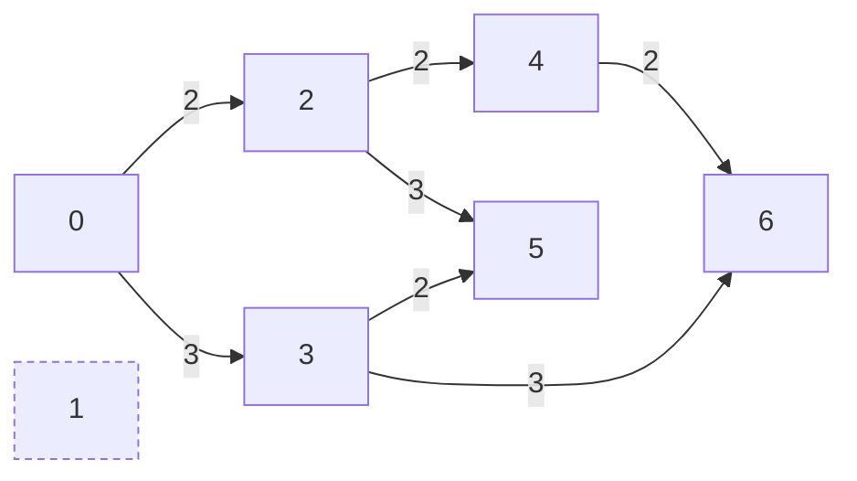

# T1 观星（star）

---

## 题意

---

给定长度为 $n$ 的序列 $a$ 和整数 $k,m,q$。把 $a_i>q$ 的位置叫作“坏位置”（多云的夜晚）。统计满足下面两个条件的区间 $[l,r]$ 的个数：

- 长度 $r-l+1\ge k$；
- 区间内坏位置的个数 $\le m$。

注意“大于 $q$”才算坏，$a_i=q$ 不算；长度是“至少 $k$”，坏位置是“至多 $m$”。答案最大约为 $\dfrac{n(n+1)}{2}\approx 2\times 10^{10}$，要用 `long long`。

## 直接做法：枚举区间，再数一遍坏位置

---

枚举左端点 $l$ 和右端点 $r$（$r\ge l+k-1$），对每个区间从 $l$ 扫到 $r$ 数坏位置，不超过 $m$ 就计数。

区间有 $O(n^2)$ 个，每个区间扫一遍 $O(n)$，总共 $O(n^3)$。$n\le 100$ 时约 $10^6$ 次操作，可以通过测试点 $1\sim 4$，得 $20$ 分。

```cpp
#include<bits/stdc++.h>
using namespace std;
const int N = 2e5 + 10;
int n,k,m,q;
int a[N];
int main(){
	freopen("star.in","r",stdin);
	freopen("star.out","w",stdout);
	cin >> n >> k >> m >> q;
	for(int i = 1; i <= n; i++) cin >> a[i];
	long long ans = 0;
	for(int l = 1; l <= n; l++){
		for(int r = l + k - 1; r <= n; r++){
			int bad = 0;
			for(int i = l; i <= r; i++){
				if(a[i] > q) bad++;
			}
			if(bad <= m) ans++;
		}
	}
	cout << ans << endl;
	return 0;
}
```

## 固定左端点向右扩展：不必每次重新数

---

上面的做法里，固定 $l$ 后，数 $[l,r]$ 和数 $[l,r+1]$ 时，前面 $r-l+1$ 个夜晚被重复数了一遍。其实 $[l,r+1]$ 的坏位置个数就是 $[l,r]$ 的个数再加上第 $r+1$ 晚是否多云。

所以固定 $l$ 后，让 $r$ 从 $l$ 开始向右走，用变量 `bad` 记录 $[l,r]$ 中的坏位置个数，每走一步只做一次判断。当 `bad` 已经超过 $m$ 时，再往右只会更多，可以直接停下。

每个 $l$ 最多向右走 $n$ 步，总共 $O(n^2)$。$n\le 5000$ 时约 $1.25\times 10^7$ 次操作，可以通过测试点 $1\sim 10$，得 $50$ 分。但当 $m$ 较大、合法区间很长时，内层循环停不下来，$n=2\times 10^5$ 时仍要约 $2\times 10^{10}$ 次操作。

```cpp
#include<bits/stdc++.h>
using namespace std;
const int N = 2e5 + 10;
int n,k,m,q;
int a[N];
int main(){
	freopen("star.in","r",stdin);
	freopen("star.out","w",stdout);
	cin >> n >> k >> m >> q;
	for(int i = 1; i <= n; i++) cin >> a[i];
	long long ans = 0;
	for(int l = 1; l <= n; l++){
		int bad = 0;
		for(int r = l; r <= n; r++){
			if(a[r] > q) bad++;
			if(bad > m) break;
			if(r - l + 1 >= k) ans++;
		}
	}
	cout << ans << endl;
	return 0;
}
```

## 特殊性质 A：$m=0$

---

$m=0$ 时区间里不能有任何坏位置，也就是说区间必须完全落在某一段“连续的好位置”里。

把序列按坏位置切开，得到若干段连续的好位置。设某一段长度为 $len$，这段里长度为 $t$ 的区间有 $len-t+1$ 个，长度至少为 $k$ 的区间共有

$$\sum_{t=k}^{len}(len-t+1)=1+2+\cdots+(len-k+1)=\frac{(len-k+1)(len-k+2)}{2}$$

个（$len<k$ 时为 $0$）。不同段之间的区间一定会跨过坏位置，不会被重复或遗漏。扫描一遍求出每段长度即可，时间 $O(n)$，保证通过测试点 $11\sim 14$，得 $20$ 分（前面 $m=0$ 的小数据点它也能答对）。

代码中在第 $n+1$ 个位置放一个“哨兵”，让最后一段也能被结算。

```cpp
#include<bits/stdc++.h>
using namespace std;
const int N = 2e5 + 10;
int n,k,m,q;
int a[N];
int main(){
	freopen("star.in","r",stdin);
	freopen("star.out","w",stdout);
	cin >> n >> k >> m >> q;
	for(int i = 1; i <= n; i++) cin >> a[i];
	long long ans = 0,len = 0;
	// 只处理 m = 0：每段连续晴朗的夜晚长度为 len，长度至少 k 的区间有 (len-k+1)(len-k+2)/2 个
	for(int i = 1; i <= n + 1; i++){
		if(i <= n && a[i] <= q){
			len++;
		}else{
			if(len >= k) ans += (len - k + 1) * (len - k + 2) / 2;
			len = 0;
		}
	}
	cout << ans << endl;
	return 0;
}
```

## 固定右端点：合法的左端点是连成一片的

---

$m>0$ 时，合法区间不再整段落在好位置里，上面的公式用不了。我们换一个角度：**固定右端点 $r$，看哪些左端点 $l$ 合法。**

先只看坏位置的条件。若 $[l,r]$ 中坏位置不超过 $m$，那么把左端点右移得到的 $[l+1,r]$ 少了一个夜晚，坏位置只会更少或不变，也合法。所以对固定的 $r$，满足坏位置条件的 $l$ 恰好是从某个最小值 $L_r$ 一直到 $r$ 的一整段。

再加上长度条件 $r-l+1\ge k$，即 $l\le r-k+1$。于是以 $r$ 为右端点的合法区间个数为

$$\max\bigl(0,\ (r-k+1)-L_r+1\bigr).$$

每个区间只有唯一的右端点，把所有 $r$ 的个数加起来就是答案，不重不漏。

剩下的问题是怎样快速求出 $L_r$。当 $r$ 增大到 $r+1$ 时，若 $[l,r+1]$ 合法，那么 $[l,r]$ 也合法（少了一个夜晚），所以 $L_{r+1}\ge L_r$：**最小合法左端点只会向右移动。**

因此用一个变量 `l` 表示当前的 $L_r$，`bad` 表示 $[l,r]$ 中的坏位置个数：

1. 右端点移到 $r$ 时，若第 $r$ 晚多云，`bad` 加一；
2. 当 `bad>m` 时，把第 `l` 晚移出区间（多云则 `bad` 减一），`l` 加一，直到 `bad<=m`；
3. 此时 `l` 就是 $L_r$，若 $r-k+1\ge l$，答案加上 $r-k+1-l+1$。

以样例 1 为例（$k=3,m=1$，坏位置为 $2,5,6$）：

| $r$ | 1 | 2 | 3 | 4 | 5 | 6 | 7 | 8 |
|---|---|---|---|---|---|---|---|---|
| $L_r$ | 1 | 1 | 1 | 1 | 3 | 6 | 6 | 6 |
| $r-k+1$ | $-1$ | 0 | 1 | 2 | 3 | 4 | 5 | 6 |
| 个数 | 0 | 0 | 1 | 2 | 1 | 0 | 0 | 1 |

合计 $5$ 个，与样例相符。$r=5$ 时区间 $[1,5]$ 含两个坏位置，`l` 必须越过第 $2$ 晚才能合法，所以 $L_5=3$。

`l` 和 `r` 都只会从 $1$ 走到 $n$，每个夜晚至多被加入一次、移出一次，总时间 $O(n)$，空间 $O(n)$。

### 参考代码

```cpp
#include<bits/stdc++.h>
using namespace std;
const int N = 2e5 + 10;
int n,k,m,q;
int a[N];
int main(){
	freopen("star.in","r",stdin);
	freopen("star.out","w",stdout);
	cin >> n >> k >> m >> q;
	for(int i = 1; i <= n; i++) cin >> a[i];
	long long ans = 0;
	int l = 1,bad = 0;   // bad：区间 [l,r] 中多云夜晚的个数
	for(int r = 1; r <= n; r++){
		if(a[r] > q) bad++;
		// 多云夜晚超过 m 个时，左端点右移
		while(bad > m){
			if(a[l] > q) bad--;
			l++;
		}
		// 以 r 结尾的合法区间，左端点可取 l ~ r-k+1
		if(r - k + 1 >= l) ans += r - k + 1 - l + 1;
	}
	cout << ans << endl;
	return 0;
}
```

## 小结

---

统计满足条件的区间个数时，如果“区间合法”在缩短区间后仍然成立，就固定右端点，合法左端点是一整段；再检查这段的起点是否随右端点单调移动，单调时用一个只向右走的指针维护它。

# T2 史莱姆（slime）

---

## 题意

---

一开始有一只大小为 $1$ 的史莱姆。喂食：某只大小加 $1$，代价 $a$；分裂：复制某一只，代价 $b$。求让大小之和至少为 $n$ 的最小代价。$T\le 10$ 组数据，$n\le 10^{12}$。

## 先算清楚：喂 $p$ 次、分 $q$ 次最多能得到多少

---

先看小例子。喂两次再分裂三次：大小变成 $3$，再得到 $4$ 只大小为 $3$ 的史莱姆，总和 $12$。如果顺序反过来，先分裂三次（$4$ 只大小为 $1$），再喂两次，总和只有 $6$。可见**先喂后分**更好：分裂时复制的是已经长大的史莱姆。

下面证明：只要喂了 $p$ 次、分裂了 $q$ 次，无论顺序如何，大小之和都不超过 $(p+1)(q+1)$，而“先把一只喂 $p$ 次，再分裂 $q$ 次”正好得到 $(p+1)(q+1)$。

把大小拆成一个个“单位”：最初那只史莱姆带有 $1$ 个单位，每次喂食给某只史莱姆增加 $1$ 个新单位。一次分裂会把被复制的那只史莱姆里的所有单位各多复制出一份。于是：

- 一个单位刚产生时只有 $1$ 份；
- 之后每次分裂，至多让它的份数增加 $1$（只有它所在的那一只被复制时才增加）。

分裂一共只有 $q$ 次，所以每个单位最后至多有 $q+1$ 份。单位共有 $p+1$ 个，大小之和就是所有单位的份数之和，不超过 $(p+1)(q+1)$。先喂后分时，每个单位都参加了全部 $q$ 次分裂，正好取到这个上界。

令 $x=p+1$（每只的最终大小），$y=q+1$（最终的只数），问题变成：

$$\text{选正整数 }x,y\text{，使 }xy\ge n,\ \text{最小化 } a(x-1)+b(y-1).$$

## 直接做法：在状态上做动态规划

---

在证明上面结论之前，也可以凭直觉“只喂最大的那只、只复制最大的那只”，用两个数描述局面：$s$ 为当前大小之和，$v$ 为最大那只的大小。（上一节说明了最优方案就在这类操作之中：先喂后分正是只操作最大的那只。）

- 喂最大的那只：$(s,v)\to(s+1,v+1)$，代价 $a$；
- 复制最大的那只：$(s,v)\to(s+v,v)$，代价 $b$。

两条操作都会让 $s$ 变大，所以按 $s$ 从小到大递推即可。$s$ 一旦达到 $n$ 就结束，把超过 $n$ 的 $s$ 都记成 $n$。设 $f[s][v]$ 为到达状态 $(s,v)$ 的最小代价，起点 $f[1][1]=0$，答案为 $\min_v f[n][v]$。

下图是 $n=4$ 时的全部状态。箭头由已经算好的状态指向新状态，同一个状态可能从多条路到达，取代价较小的一条。



$a=b=1$ 时，$(4,2)$ 由 $(2,2)$ 复制得到，代价 $2$，是最优的。图中 $(4,2)$ 有三条入边、$(4,3)$ 有两条入边，这就是不同操作顺序到达同一局面后合并的地方。

状态共 $O(n^2)$ 个，每个两条转移，单组 $O(n^2)$。$n\le 1000$ 时可以通过测试点 $1\sim 3$，得 $15$ 分。

```cpp
#include<bits/stdc++.h>
using namespace std;
// 只增大最大的史莱姆、只复制最大的史莱姆：状态 (总大小 s, 最大一只的大小 v)
int T;
long long n,a,b;
long long f[1010][1010];
int main(){
	freopen("slime.in","r",stdin);
	freopen("slime.out","w",stdout);
	cin >> T;
	while(T--){
		cin >> n >> a >> b;
		for(int s = 1; s <= n; s++){
			for(int v = 1; v <= n; v++) f[s][v] = -1;
		}
		f[1][1] = 0;
		for(int s = 1; s < n; s++){
			for(int v = 1; v <= s; v++){
				if(f[s][v] == -1) continue;
				// 把最大的一只加 1
				int s1 = s + 1,v1 = v + 1;
				if(s1 > n) s1 = n;
				if(v1 > n) v1 = n;
				if(f[s1][v1] == -1 || f[s][v] + a < f[s1][v1]) f[s1][v1] = f[s][v] + a;
				// 复制最大的一只
				int s2 = s + v;
				if(s2 > n) s2 = n;
				if(f[s2][v] == -1 || f[s][v] + b < f[s2][v]) f[s2][v] = f[s][v] + b;
			}
		}
		long long ans = -1;
		for(int v = 1; v <= n; v++){
			if(f[n][v] != -1 && (ans == -1 || f[n][v] < ans)) ans = f[n][v];
		}
		cout << ans << endl;
	}
	return 0;
}
```

## 枚举最终大小 $x$

---

有了上一节的结论，只需在 $xy\ge n$ 的正整数对中找代价最小的。固定 $x$ 后，代价随 $y$ 增大而增大，所以 $y$ 取满足 $xy\ge n$ 的最小值 $y=\lceil n/x\rceil$，代码中写作 `(n + x - 1) / x`。$x$ 取到 $n$ 时 $y=1$，更大的 $x$ 只会更贵，所以 $x$ 从 $1$ 枚举到 $n$ 即可。

单组 $O(n)$，共 $O(Tn)$。$n\le 10^6$ 时约 $10^7$ 次操作，可以通过测试点 $1\sim 9$，得 $45$ 分。

```cpp
#include<bits/stdc++.h>
using namespace std;
int T;
long long n,a,b;
int main(){
	freopen("slime.in","r",stdin);
	freopen("slime.out","w",stdout);
	cin >> T;
	while(T--){
		cin >> n >> a >> b;
		long long ans = -1;
		// 枚举每只的最终大小 x，y = ceil(n / x)
		for(long long x = 1; x <= n; x++){
			long long y = (n + x - 1) / x;
			long long cost = a * (x - 1) + b * (y - 1);
			if(ans == -1 || cost < ans) ans = cost;
		}
		cout << ans << endl;
	}
	return 0;
}
```

## 特殊性质 A：$a\ge b$ 时只需枚举到 $\sqrt n$

---

$n=10^{12}$ 时枚举所有 $x$ 太慢。观察样例 1：$a=b=1$ 时最优的 $x=3,y=4$ 都在 $\sqrt{10}$ 附近；$a\ge b$ 时，喂食更贵，直觉上 $x$ 不应太大。

设 $(x,y)$ 满足 $xy\ge n$ 且 $x>y$。交换成 $(y,x)$ 后乘积不变，代价的变化为

$$\bigl[a(y-1)+b(x-1)\bigr]-\bigl[a(x-1)+b(y-1)\bigr]=(a-b)(y-x)\le 0,$$

因为 $a-b\ge 0$、$y-x<0$，交换后不会更贵。

在所有最优解中取 $x$ 最小的一个，把它的 $y$ 换成 $\lceil n/x\rceil$（不会更贵，仍是最优解）。如果此时 $x>y$，交换后得到的 $(y,x)$ 也是最优解，而它的第一个数 $y$ 比 $x$ 小，与“$x$ 最小”矛盾。所以存在最优解满足 $x\le\lceil n/x\rceil$。

设 $s=\lfloor\sqrt n\rfloor$，即满足 $s^2\le n$ 的最大整数。若 $x\ge s+2$，则 $x(x-1)\ge(s+2)(s+1)>(s+1)^2>n$，于是 $x-1>n/x$，即 $\lceil n/x\rceil\le x-1<x$，不满足 $x\le\lceil n/x\rceil$。所以只需枚举 $x=1,2,\ldots,s+1$，单组约 $10^6$ 次，保证通过测试点 $10\sim 13$，得 $20$ 分（前面满足 $a\ge b$ 的数据点它也能答对）。

求 $s$ 时先用 `sqrt` 得到近似值，再用两个 `while` 循环修正，避免浮点误差。

```cpp
#include<bits/stdc++.h>
using namespace std;
// 只枚举 x <= s + 1：a >= b 时正确
int T;
long long n,a,b;
int main(){
	freopen("slime.in","r",stdin);
	freopen("slime.out","w",stdout);
	cin >> T;
	while(T--){
		cin >> n >> a >> b;
		long long s = (long long)sqrt((double)n);
		while(s * s > n) s--;
		while((s + 1) * (s + 1) <= n) s++;
		long long ans = -1;
		for(long long x = 1; x <= s + 1; x++){
			long long y = (n + x - 1) / x;
			long long cost = a * (x - 1) + b * (y - 1);
			if(ans == -1 || cost < ans) ans = cost;
		}
		cout << ans << endl;
	}
	return 0;
}
```

## 满分：两边各枚举到 $\sqrt n$

---

$a<b$ 时，分裂更贵，最优的 $x$ 可能很大。样例 2 的第二组 $n=10^{12},a=1,b=10^6$，最优解 $x=10^9$、$y=1000$，远超 $\sqrt n=10^6$，只枚举 $x\le s+1$ 会得到错误答案。

不必区分 $a,b$ 的大小。设最优解为 $(x,y)$，其中 $y=\lceil n/x\rceil$：

- 若 $x\le s+1$，枚举 $x$ 时会找到它；
- 若 $x\ge s+2$，则 $x>\sqrt n$，所以 $y=\lceil n/x\rceil\le\lceil\sqrt n\rceil\le s+1$。枚举 $y$ 时取 $x'=\lceil n/y\rceil$，因为 $xy\ge n$，有 $x'\le x$，代价不会更大，所以这一轮也能找到最优值。

于是再枚举 $y=1,\ldots,s+1$，取 $x=\lceil n/y\rceil$，两轮取最小值即为答案。也可以用前一节的交换论证理解：$a\le b$ 时总有最优解满足 $y\le x$，与 $a\ge b$ 的情形对称。

单组 $O(\sqrt n)$，约 $2\times 10^6$ 次，十组共约 $2\times 10^7$ 次。$a(x-1)$ 最大约 $10^6\times 10^{12}=10^{18}$，在 `long long` 范围内。

### 参考代码

```cpp
#include<bits/stdc++.h>
using namespace std;
int T;
long long n,a,b;
int main(){
	freopen("slime.in","r",stdin);
	freopen("slime.out","w",stdout);
	cin >> T;
	while(T--){
		cin >> n >> a >> b;
		// s 为 n 的整数平方根：s * s <= n < (s + 1) * (s + 1)
		long long s = (long long)sqrt((double)n);
		while(s * s > n) s--;
		while((s + 1) * (s + 1) <= n) s++;
		long long ans = -1;
		// 最终有 y 只史莱姆、每只大小为 x，需要 x * y >= n，花费 a(x-1) + b(y-1)
		// 情况一：x <= s + 1，枚举 x，y 取最小的 ceil(n / x)
		for(long long x = 1; x <= s + 1; x++){
			long long y = (n + x - 1) / x;
			long long cost = a * (x - 1) + b * (y - 1);
			if(ans == -1 || cost < ans) ans = cost;
		}
		// 情况二：x > s + 1，此时 y <= s + 1，枚举 y，x 取最小的 ceil(n / y)
		for(long long y = 1; y <= s + 1; y++){
			long long x = (n + y - 1) / y;
			long long cost = a * (x - 1) + b * (y - 1);
			if(cost < ans) ans = cost;
		}
		cout << ans << endl;
	}
	return 0;
}
```

## 小结

---

两个正整数的乘积至少为 $n$ 时，较小的那个不超过 $\lceil\sqrt n\rceil$；固定较小的一个，另一个取最小可行值。分别枚举两边，就能在 $O(\sqrt n)$ 内覆盖所有可能的最优解。

# T3 旋律（melody）

---

## 题意

---

给定序列 $a_1,\ldots,a_n$，可以删去至多 $k$ 个数（$k\le 20$），剩下的数按原顺序相接。求新序列中最长的严格上升连续段的长度。

## 直接做法：枚举删哪些数

---

用搜索依次决定每个数删或不删，删的个数不超过 $k$。到达末尾后，在留下的数中扫一遍，求最长的严格上升连续段。

删法至多 $2^n$ 种，每种扫描 $O(n)$，共 $O(2^n n)$。$n\le 18$ 时约 $5\times 10^6$ 次，可以通过测试点 $1\sim 3$。$k=0$ 时只有一种删法，这个程序退化为扫描一遍，也能通过测试点 $4\sim 6$，共 $30$ 分。

```cpp
#include<bits/stdc++.h>
using namespace std;
const int N = 2e5 + 10;
int n,k,m,ans;
int a[N],b[N];
// 依次决定每个音符删不删，del 为已删除的个数，保留的音符放在 b[1..m]
void dfs(int i,int del){
	if(i > n){
		int len = 0;
		for(int t = 1; t <= m; t++){
			if(t > 1 && b[t - 1] < b[t]) len++;
			else len = 1;
			ans = max(ans,len);
		}
		return;
	}
	b[++m] = a[i];
	dfs(i + 1,del);
	m--;
	if(del < k) dfs(i + 1,del + 1);
}
int main(){
	freopen("melody.in","r",stdin);
	freopen("melody.out","w",stdout);
	cin >> n >> k;
	for(int i = 1; i <= n; i++) cin >> a[i];
	dfs(1,0);
	cout << ans << endl;
	return 0;
}
```

## $k=0$：原序列的最长上升段

---

不能删数时，答案就是原序列中最长的严格上升连续段。从左到右扫描，`len` 表示以当前位置结尾的上升段长度：若 $a_{i-1}<a_i$ 则 `len` 加一，否则重新记为 $1$。时间 $O(n)$，可以通过测试点 $4\sim 6$。

```cpp
#include<bits/stdc++.h>
using namespace std;
const int N = 2e5 + 10;
int n,k;
int a[N];
int main(){
	freopen("melody.in","r",stdin);
	freopen("melody.out","w",stdout);
	cin >> n >> k;
	for(int i = 1; i <= n; i++) cin >> a[i];
	int ans = 0,len = 0;
	for(int i = 1; i <= n; i++){
		if(i > 1 && a[i - 1] < a[i]) len++;
		else len = 1;
		ans = max(ans,len);
	}
	cout << ans << endl;
	return 0;
}
```

## $k=1$：删一个数，把两段接起来

---

只删一个数时，最优情况要么不删，要么删掉第 $i$ 个数后，把“以 $i-1$ 结尾的上升段”和“以 $i+1$ 开头的上升段”接起来，接上的条件是 $a_{i-1}<a_{i+1}$。

预处理 $l_i$ 为以 $i$ 结尾的最长上升段长度，$r_i$ 为以 $i$ 开头的最长上升段长度，答案为 $\max\bigl(\max_i l_i,\ \max_{a_{i-1}<a_{i+1}}(l_{i-1}+r_{i+1})\bigr)$。为什么只要接上两段的最长部分？删掉 $i$ 后，跨过原位置 $i$ 的上升段，左半部分一定是以 $i-1$ 结尾的上升段，右半部分一定是以 $i+1$ 开头的上升段，两边各取最长的不会更差。

时间 $O(n)$，保证通过测试点 $4\sim 10$，得 $35$ 分（小数据点中最优方案只需删一个数时也能答对）。

```cpp
#include<bits/stdc++.h>
using namespace std;
const int N = 2e5 + 10;
int n,k;
int a[N],l[N],r[N];
int main(){
	freopen("melody.in","r",stdin);
	freopen("melody.out","w",stdout);
	cin >> n >> k;
	for(int i = 1; i <= n; i++) cin >> a[i];
	// l[i]：以 i 结尾的最长上升段；r[i]：以 i 开头的最长上升段
	for(int i = 1; i <= n; i++){
		if(i > 1 && a[i - 1] < a[i]) l[i] = l[i - 1] + 1;
		else l[i] = 1;
	}
	for(int i = n; i >= 1; i--){
		if(i < n && a[i] < a[i + 1]) r[i] = r[i + 1] + 1;
		else r[i] = 1;
	}
	int ans = 0;
	for(int i = 1; i <= n; i++) ans = max(ans,l[i]);
	if(k >= 1){
		// 删掉第 i 个，把 i-1 结尾的段和 i+1 开头的段接起来
		for(int i = 2; i < n; i++){
			if(a[i - 1] < a[i + 1]) ans = max(ans,l[i - 1] + r[i + 1]);
		}
	}
	cout << ans << endl;
	return 0;
}
```

## 删得更多时：最后的上升段长什么样

---

$k\ge 2$ 时，删掉的数可能分散在好几处，例如样例 1 删去 $5$ 和 $9$，把三小段 $1$、$2,3$、$4,6$ 接成一段。若继续按“几段接起来”分类，要枚举接哪些段、每处删几个，情况越来越多。

换个角度，直接看最后得到的那个上升段。设它由原序列中下标为 $i_1<i_2<\cdots<i_t$ 的数组成，那么：

- $a_{i_1}<a_{i_2}<\cdots<a_{i_t}$；
- 在新序列中它们相邻，所以原序列中 $i_1$ 到 $i_t$ 之间没被选中的数都必须删掉，共 $(i_t-i_1+1)-t$ 个，这个数不超过 $k$；
- $i_1$ 左边、$i_t$ 右边的数删不删都无所谓，不用删。

反过来，只要选出的下标满足前两条，删掉中间没选的数就得到一个长度为 $t$ 的上升段。所以问题变成：**选一串下标递增、数值严格递增的数，中间“跳过”的数加起来不超过 $k$，让选出的个数最多。**

## 从搜索到动态规划

---

按从左到右的顺序挑选这串数。假设已经选到下标 $i$，并且已经跳过了 $j$ 个数。接下来能选哪些数、还能跳过几个，只与“最后一个选的是谁”和“已经跳过多少”有关，与前面具体选了哪些无关。所以把 $(i,j)$ 作为状态。

定义 $f[i][j]$：一串以第 $i$ 个数结尾的上升数（第 $i$ 个数必须被选），中间跳过的数**不超过** $j$ 个时，最多能选几个数。

考虑这串数中 $i$ 的前一个数 $p$，设 $p$ 与 $i$ 之间跳过了 $d=i-p-1$ 个数，则：

- 这串数只有 $i$ 一个数：长度为 $1$；
- 否则 $d\le j$，且必须 $a_p<a_i$，前面部分跳过的数不超过 $j-d$ 个，长度为 $f[p][j-d]+1$。

这些情况按“前一个数是谁”互不重叠，且覆盖了所有可能，所以

$$f[i][j]=\max\Bigl(1,\ \max_{\substack{0\le d\le j,\ p=i-1-d\ge 1\\ a_p<a_i}}\bigl(f[p][j-d]+1\bigr)\Bigr).$$

下图是样例 2（$a=1,5,2,3,4,2$，$k=1$）中有转移的部分。箭头从 $(p,j-d)$ 指向 $(i,j)$，边上的数字是 $d$。



计算结果：$f[3][1]=2$（跳过 $5$，接在 $1$ 后面），$f[4][1]=3$，$f[5][1]=\max(f[4][1]+1,\ f[3][0]+1)=4$。$(5,1)$ 有两条入边：一条来自“$1$，跳过 $5$，$2,3$”这串数的延续，另一条来自“$2$，跳过 $3$”，取较大的 $4$。答案为 $\max_i f[i][k]=4$。

计算 $f[i][\cdot]$ 只用到下标更小的 $f[p][\cdot]$，所以按 $i$ 从小到大计算。代码中枚举 $d$ 时，一旦 $p<1$ 就停止。答案为所有 $f[i][j]$ 的最大值（因为 $f[i][j]$ 随 $j$ 不减，也就是 $\max_i f[i][k]$）。

状态有 $n(k+1)$ 个，每个状态枚举 $d\le j$，总共约 $n\cdot\frac{(k+1)(k+2)}{2}\approx 2\times 10^5\times 231\approx 4.6\times 10^7$ 次，空间是一个 $n\times 21$ 的 `int` 数组，约 $17$ MiB。

### 参考代码

```cpp
#include<bits/stdc++.h>
using namespace std;
const int N = 2e5 + 10;
const int K = 25;
int n,k;
int a[N];
// f[i][j]：保留第 i 个音符、它是上升段的最后一个，段内最多删除 j 个音符时，上升段的最大长度
int f[N][K];
int main(){
	freopen("melody.in","r",stdin);
	freopen("melody.out","w",stdout);
	cin >> n >> k;
	for(int i = 1; i <= n; i++) cin >> a[i];
	int ans = 0;
	for(int i = 1; i <= n; i++){
		for(int j = 0; j <= k; j++){
			f[i][j] = 1;
			// 上升段中 i 的前一个保留的音符是 p，中间删掉 g = i - p - 1 个
			for(int g = 0; g <= j; g++){
				int p = i - 1 - g;
				if(p < 1) break;
				if(a[p] < a[i]) f[i][j] = max(f[i][j],f[p][j - g] + 1);
			}
			ans = max(ans,f[i][j]);
		}
	}
	cout << ans << endl;
	return 0;
}
```

## 小结

---

“删去若干个数后求最优的连续段”，可以转化为“在原序列中选一串数，中间跳过的数计入删除次数”。把“最后选的位置”和“已用的删除次数”作为状态，枚举前一个选的位置，就得到一维序列上带次数限制的动态规划。

# T4 合唱（chorus）

---

## 题意

---

$n$ 个数排成一圈，每次可以把一个数加一或减一。要求最后圆圈上每一段极长的相等连续段都至少有 $L$ 个数（所有数都相等时也满足）。求最少操作次数。$2\le L\le 10$，$n\le 2\times 10^5$。

## 把“声部”看成“分段”

---

最终的数组可以看成：把圆圈切成若干段，每段都改成同一个数。

- 若最终数组合格，把每个极长相等段作为一段，每段长度都不少于 $L$。
- 反过来，若把圆圈切成每段长度都不少于 $L$ 的若干段、每段改成同一个数，那么即使相邻两段恰好改成同一个数，它们会合并成更长的一段，长度仍不少于 $L$，所以也合格。

于是问题变成：**把圆圈切成若干段，每段至少 $L$ 个数，每段的代价是把段内所有数改成同一个数的最少次数，求总代价最小。**

## 一段数改成同一个数：改成中位数

---

把一段数排序为 $b_1\le b_2\le\cdots\le b_t$，要选一个数 $c$ 使 $\sum|b_i-c|$ 最小。把它们首尾配对：$(b_1,b_t),(b_2,b_{t-1}),\ldots$。对每一对，$|b_i-c|+|b_{t+1-i}-c|\ge b_{t+1-i}-b_i$，当且仅当 $c$ 在 $[b_i,b_{t+1-i}]$ 之间时取等号。中位数 $b_{\lceil t/2\rceil}$ 落在每一对的区间内（$t$ 为奇数时中间那个数单独成对，代价为 $0$），所以所有对同时取到最小值。

因此一段的代价为 $\sum|b_i-b_{\lceil t/2\rceil}|$。长度为 $2$ 时就是 $|x-y|$，长度为 $3$ 时就是最大值减最小值。

## 直接做法：枚举每段的开头

---

用 $n$ 位二进制数枚举圆圈上哪些位置是某一段的开头（至少一个）。相邻两个开头之间就是一段，检查每段长度是否不少于 $L$，再把每段排序后按中位数计算代价。

共 $2^n$ 种，每种 $O(n\log n)$。$n\le 10$ 时可以通过测试点 $1\sim 2$，得 $10$ 分。只有一个开头时，整圈就是一段。

```cpp
#include<bits/stdc++.h>
using namespace std;
// 枚举环上哪些位置是一段的开头
int n,L;
long long a[30];
long long segCost(int st,int len){
	vector<long long> v;
	for(int t = 0; t < len; t++) v.push_back(a[(st + t) % n]);
	sort(v.begin(),v.end());
	long long mid = v[(len - 1) / 2],s = 0;
	for(int t = 0; t < len; t++) s += abs(v[t] - mid);
	return s;
}
int main(){
	freopen("chorus.in","r",stdin);
	freopen("chorus.out","w",stdout);
	cin >> n >> L;
	for(int i = 0; i < n; i++) cin >> a[i];
	long long ans = -1;
	for(int mask = 1; mask < (1 << n); mask++){
		vector<int> st;
		for(int i = 0; i < n; i++){
			if((mask >> i) & 1) st.push_back(i);
		}
		int c = st.size();
		bool ok = true;
		long long tot = 0;
		for(int j = 0; j < c; j++){
			int len;
			if(c == 1) len = n;
			else len = (st[(j + 1) % c] - st[j] + n) % n;
			if(len < L){
				ok = false;
				break;
			}
			tot += segCost(st[j],len);
		}
		if(ok && (ans == -1 || tot < ans)) ans = tot;
	}
	cout << ans << endl;
	return 0;
}
```

## $L=2$：每段只需 2 或 3 个数

---

一段太长时可以切开。设一段有 $t\ge 2L$ 个数，把它切成前 $L$ 个和后 $t-L$ 个（后者也不少于 $L$）。如果两部分都改成原来那段的公共值，代价与原来相同；两部分各自改成自己的中位数，代价只会更小或相等。所以**总存在一个最优方案，每段长度都在 $L$ 到 $2L-1$ 之间**。$L=2$ 时就是每段 $2$ 个或 $3$ 个数。

先看圆圈被剪开成一条链的情况。设链为 $c_1,\ldots,c_n$，$f[j]$ 为把前 $j$ 个数分好段的最小代价，最后一段要么是最后 $2$ 个数，要么是最后 $3$ 个数：

$$f[j]=\min\bigl(f[j-2]+|c_{j-1}-c_j|,\ f[j-3]+\max(c_{j-2},c_{j-1},c_j)-\min(c_{j-2},c_{j-1},c_j)\bigr),$$

$f[0]=0$，$f[1]$ 不可能（记为无穷大），答案是 $f[n]$。

再处理圆圈：最优方案中，包含第 $1$ 个数的那一段长度不超过 $3$，所以位置 $1,2,3$ 中一定有某一段的开头（详细理由见下一节）。依次尝试从位置 $1,2,3$ 剪开，分别做一遍链上的 DP，取最小值。

下图是样例 2 从位置 $3$ 剪开后的链 $1,7,2,9,3,8$。节点 $j$ 表示 $f[j]$，箭头从 $j-t$ 指向 $j$，边上的数字是最后一段的长度 $t$。



各值为 $f[2]=6,\ f[3]=6,\ f[4]=6+7=13,\ f[5]=\min(6+7,\ 6+6)=12,\ f[6]=\min(13+5,\ 6+6)=12$。$f[5]$ 与 $f[6]$ 都有两条入边，取较小者。从位置 $1$ 或 $2$ 剪开，最好只能得到 $14$（两段各 $3$ 个数），所以答案是 $12$。

每次 DP 为 $O(n)$，共 $3$ 次，时间 $O(n)$，可以通过测试点 $3\sim 6$，得 $20$ 分。

```cpp
#include<bits/stdc++.h>
using namespace std;
const int N = 4e5 + 10;
// L = 2：每段长 2 或 3，长 2 代价 |x-y|，长 3 代价 max-min；第一段起点试 1~3
const long long INF = 4e18;
int n,L;
long long a[N],f[N];
int main(){
	freopen("chorus.in","r",stdin);
	freopen("chorus.out","w",stdout);
	cin >> n >> L;
	for(int i = 1; i <= n; i++){
		cin >> a[i];
		a[i + n] = a[i];
	}
	long long ans = INF;
	for(int s = 0; s <= 2 && s < n; s++){
		f[0] = 0;
		for(int j = 1; j <= n; j++){
			f[j] = INF;
			if(j >= 2 && f[j - 2] != INF){
				f[j] = min(f[j],f[j - 2] + abs(a[s + j] - a[s + j - 1]));
			}
			if(j >= 3 && f[j - 3] != INF){
				long long x = a[s + j - 2],y = a[s + j - 1],z = a[s + j];
				long long mx = max(x,max(y,z)),mn = min(x,min(y,z));
				f[j] = min(f[j],f[j - 3] + mx - mn);
			}
		}
		ans = min(ans,f[n]);
	}
	cout << ans << endl;
	return 0;
}
```

## 一般的 $L$：每段 $L\sim 2L-1$ 个数

---

上一节的切分论证对任意 $L$ 都成立：每段长度只需取 $L,L+1,\ldots,2L-1$。链上的 DP 变为

$$f[j]=\min_{L\le t\le \min(2L-1,\,j)}\bigl(f[j-t]+\mathrm{cost}(j-t+1,t)\bigr),$$

其中 $\mathrm{cost}(i,t)$ 表示从第 $i$ 个数开始的 $t$ 个数改成中位数的次数。

$\mathrm{cost}$ 可以预处理：对每个起点 $i$，依次把第 $i,i+1,\ldots$ 个数插入一个有序的小数组（插入排序的一步），长度达到 $t\ge L$ 时取中位数，算一遍绝对值之和。每个起点最多插入 $2L-1$ 个数、计算 $L$ 次代价，共 $O(nL^2)$。圆圈用“把数组复制一份接在后面”来处理，从位置 $s+1$ 剪开的链就是 $a_{s+1},\ldots,a_{s+n}$。

如果还没想到断环只需试少数几个位置，可以把 $n$ 个剪开位置全部试一遍，每次 DP 为 $O(nL)$，共 $O(n^2L)$。$n\le 1000$ 时约 $10^7$ 次，可以通过测试点 $1\sim 2$ 和 $7\sim 11$，得 $35$ 分。

```cpp
#include<bits/stdc++.h>
using namespace std;
const int N = 4e5 + 10;
// 每段长度只需 L ~ 2L-1，但第一段起点把 n 个位置都试一遍：O(n^2 L)
const long long INF = 4e18;
int n,L;
long long a[N],f[N];
long long cost[N][20];
long long b[25];
int main(){
	freopen("chorus.in","r",stdin);
	freopen("chorus.out","w",stdout);
	cin >> n >> L;
	for(int i = 1; i <= n; i++){
		cin >> a[i];
		a[i + n] = a[i];
	}
	int maxT = 2 * L - 1;
	for(int i = 1; i <= 2 * n; i++){
		int m = 0;
		for(int t = 1; t <= maxT && i + t - 1 <= 2 * n; t++){
			long long x = a[i + t - 1];
			int p = ++m;
			while(p > 1 && b[p - 1] > x){
				b[p] = b[p - 1];
				p--;
			}
			b[p] = x;
			if(t >= L){
				long long mid = b[(t + 1) / 2],s = 0;
				for(int j = 1; j <= t; j++) s += abs(b[j] - mid);
				cost[i][t] = s;
			}
		}
	}
	long long ans = INF;
	for(int s = 0; s < n; s++){
		f[0] = 0;
		for(int j = 1; j <= n; j++){
			f[j] = INF;
			for(int t = L; t <= maxT && t <= j; t++){
				if(f[j - t] == INF) continue;
				f[j] = min(f[j],f[j - t] + cost[s + j - t + 1][t]);
			}
		}
		ans = min(ans,f[n]);
	}
	cout << ans << endl;
	return 0;
}
```

## 断环只需试 $2L-1$ 个位置

---

取一个每段长度都在 $L\sim 2L-1$ 之间的最优方案，看包含第 $1$ 个数的那一段，设它从位置 $st$ 开始、共 $t\le 2L-1$ 个数：

- 若 $st=1$，从位置 $1$ 剪开即可；
- 否则这一段从圆圈末尾绕到开头，它的下一段从位置 $st+t-n$ 开始，而它覆盖了位置 $1,\ldots,st+t-n-1$，所以 $st+t-n-1\le t-1$，下一段的开头不超过 $t\le 2L-1$。

所以位置 $1,2,\ldots,2L-1$ 中一定有某一段的开头（$n<2L-1$ 时就是全部位置）。从这个开头剪开，方案中的每一段在链上都是连续的，链上的 DP 一定能找到它。依次尝试从位置 $s+1$（$0\le s\le\min(2L-2,n-1)$）剪开，取最小值即为答案。

代码中 `maxS` 就是最后一个要试的 $s$。预处理代价 $O(nL^2)$，$2L-1$ 次 DP 共 $O(nL^2)$，$L=10$、$n=2\times 10^5$ 时约 $4\times 10^7$ 次。复制后的数组长 $2n$，代价表 `cost` 约 $4\times 10^5\times 20$ 个 `long long`，约 $61$ MiB。答案最大约 $2\times 10^5\times 10^9$，要用 `long long`。

### 参考代码

```cpp
#include<bits/stdc++.h>
using namespace std;
const int N = 4e5 + 50;
const long long INF = 4e18;
int n,L;
long long a[N];
// cost[i][t]：从位置 i 开始、长度为 t 的一段全部改成同一个数的最小代价（t 在 L ~ 2L-1 之间）
long long cost[N][20];
long long b[25];
long long f[N];
int main(){
	freopen("chorus.in","r",stdin);
	freopen("chorus.out","w",stdout);
	cin >> n >> L;
	for(int i = 1; i <= n; i++){
		cin >> a[i];
		a[i + n] = a[i];   // 复制一份，处理环
	}
	int maxT = 2 * L - 1;
	int maxS = min(maxT - 1,n - 1);   // 环上第一段的起点只需试 1 ~ maxS+1
	for(int i = 1; i <= maxS + n; i++){
		int m = 0;
		for(int t = 1; t <= maxT && i + t - 1 <= 2 * n; t++){
			// 把 a[i+t-1] 插入有序数组 b[1..m]
			long long x = a[i + t - 1];
			int p = ++m;
			while(p > 1 && b[p - 1] > x){
				b[p] = b[p - 1];
				p--;
			}
			b[p] = x;
			if(t >= L){
				long long mid = b[(t + 1) / 2],s = 0;   // 改成中位数代价最小
				for(int j = 1; j <= t; j++) s += abs(b[j] - mid);
				cost[i][t] = s;
			}
		}
	}
	long long ans = INF;
	for(int s = 0; s <= maxS; s++){
		// 从位置 s+1 起把环剪开，f[j]：前 j 个数分好段的最小代价
		f[0] = 0;
		for(int j = 1; j <= n; j++){
			f[j] = INF;
			for(int t = L; t <= maxT && t <= j; t++){
				if(f[j - t] == INF) continue;
				long long v = f[j - t] + cost[s + j - t + 1][t];
				if(v < f[j]) f[j] = v;
			}
		}
		if(f[n] < ans) ans = f[n];
	}
	cout << ans << endl;
	return 0;
}
```

## 小结

---

“每段至少 $L$ 个”的分段问题，若长段可以无损地切成短段，就能把段长限制在 $L\sim 2L-1$，转移只需枚举少数几个长度。环形分段时，看包含第一个元素的那一段：它的长度有上限，于是只需在开头附近尝试少数几个剪开位置。
