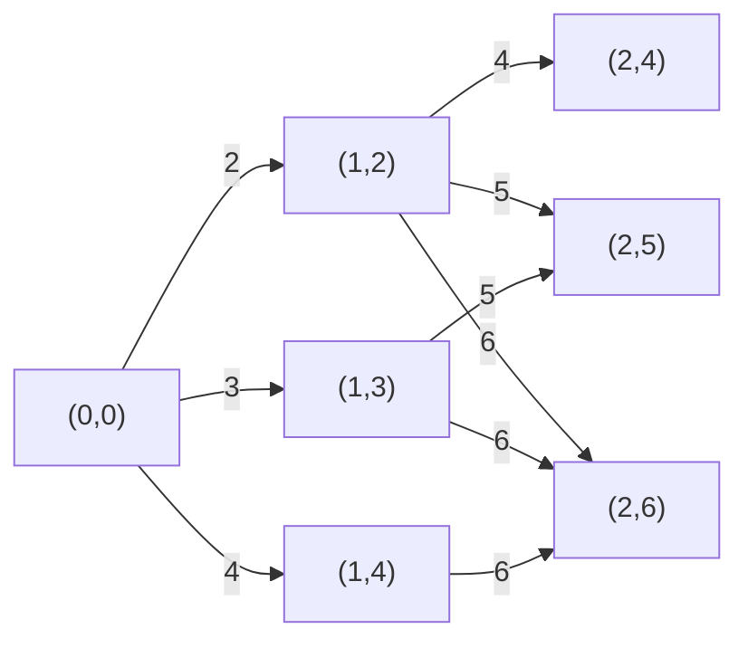
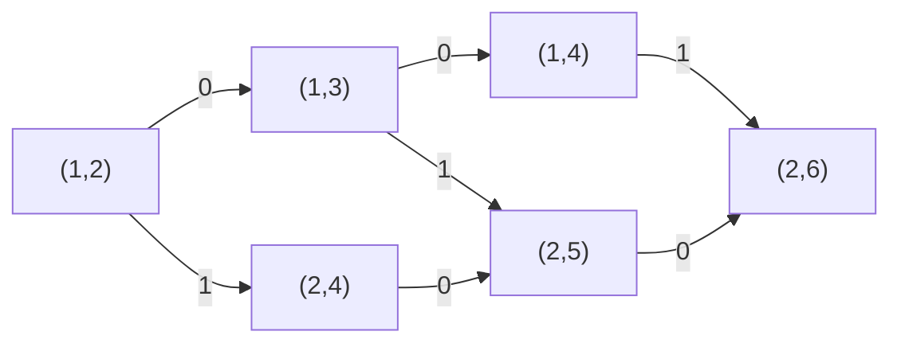

# T1 配对（pairs）

---

要统计的是下标对，条件中的标签和编号不能互换。把条件拆开看，左端点要求 $a_i<i$，右端点要求 $a_j<j$，两端之间还要求 $i<a_j$。所有不等号都严格。

## 逐对检查：先得到 30 分

---

枚举右端点 $j$，再枚举它前面的 $i=1,\ldots,j-1$，按原式检查三次比较，满足就把答案加一。每个配对都有唯一的右端点和左端点，因而不会重复或遗漏。

一组数据要检查 $n(n-1)/2$ 对，时间为 $O(n^2)$，存储标签需要 $O(n)$ 空间。若各组长度为 $n_1,n_2,\ldots$，整个输入文件的时间为 $O(\sum n_r^2)$。前六个点同时限制单组长度和总长度，至多约检查 $1500\times20000/2=1500$ 万对，保证得到 $30$ 分。

```cpp
#include<bits/stdc++.h>
using namespace std;
const int N = 2e5 + 10;
int n,t,a[N];
int main(){
	freopen("pairs.in","r",stdin);
	freopen("pairs.out","w",stdout);
	ios::sync_with_stdio(false);
	cin.tie(0);
	cin >> t;
	while(t--){
		cin >> n;
		for(int i = 1; i <= n; i++) cin >> a[i];
		long long ans = 0;
		for(int j = 2; j <= n; j++){
			for(int i = 1; i < j; i++){
				if(a[i] < i && i < a[j] && a[j] < j) ans++;
			}
		}
		cout << ans << '\n';
	}
	return 0;
}
```

## 固定右端点，把枚举范围缩到标签之前

---

直接枚举中，很多左端点还没有读取自己的标签，就已经能被排除。例如右端点为 $j=100$、标签为 $a_j=4$，条件 $i<4$ 表明只有编号 $1,2,3$ 可能成为左端点，没有必要检查 $4$ 到 $99$。

先判断右端点自己的条件。若 $a_j\ge j$，没有任何左端点能与它配对；否则，只需枚举 $1\le i<a_j$，检查 $a_i<i$。因为已经有 $i<a_j<j$，无需再次检查 $i<j$。当 $a_j=0$ 或 $1$ 时，这个编号区间为空，贡献为 $0$。

这一改动把每个右端点的工作量从 $j-1$ 降到 $\max(0,a_j-1)$，仅对 $a_j<j$ 的位置枚举。如果标签最大值为 $V$，计入读入后，单组上界为 $O(n(1+\min(n,V)))$；整个输入文件为 $O(\sum n_r(1+\min(n_r,V)))$，空间仍为 $O(n)$。

它保留前六点的保证；在第七到十二点，$V\le300$，总枚举次数不超过 $299\times2\times10^5$，因此再增加 $30$ 分，合计保证 $60$ 分。一般数据中，很多 $a_j$ 都可能接近 $j$，总次数仍会达到二次量级，接下来要去掉反复扫描同一前缀的工作。

```cpp
#include<bits/stdc++.h>
using namespace std;
const int N = 2e5 + 10;
int n,t,a[N];
int main(){
	freopen("pairs.in","r",stdin);
	freopen("pairs.out","w",stdout);
	ios::sync_with_stdio(false);
	cin.tie(0);
	cin >> t;
	while(t--){
		cin >> n;
		for(int i = 1; i <= n; i++) cin >> a[i];
		long long ans = 0;
		for(int j = 1; j <= n; j++){
			if(a[j] >= j) continue;
			for(int i = 1; i < a[j]; i++){
				if(a[i] < i) ans++;
			}
		}
		cout << ans << '\n';
	}
	return 0;
}
```

## 预先数出每个前缀内有多少个合格左端点

---

对于某个编号 $i$，它能否作为左端点，只由 $a_i<i$ 决定，与当前右端点无关。上一个程序不断问同一个类型的问题：“前 $x$ 个位置中，有多少位置满足自己的标签小于编号？”

因此定义 $s[x]$ 为编号 $1$ 到 $x$ 中满足 $a_i<i$ 的位置数。空前缀没有位置，令 $s[0]=0$。从前往后读入时，在 $s[i-1]$ 的基础上判断第 $i$ 个位置是否合格，得到

\[
s[i]=s[i-1]+[a_i<i].
\]

方括号表示条件成立时为 $1$，否则为 $0$。例如标签为 $0,2,1,3,4$ 时，合格编号是 $1,3,4,5$，于是 $s[0],s[1],\ldots,s[5]$ 依次为 $0,1,1,2,3,4$。对右端点 $j=5$，$a_j=4$，需要的是编号 $1$ 到 $3$ 的合格位置，数量恰为 $s[3]=2$，对应 $(1,5)$ 和 $(3,5)$。编号 $4$ 不可加入，因为这里要求 $i<4$。

固定 $j$，若 $0<a_j<j$，合法左端点正好是前 $a_j-1$ 个位置中满足 $a_i<i$ 的位置，所以它的贡献为 $s[a_j-1]$。必要性来自原式的三个比较；反过来，任何被这个前缀计数包含的位置都满足 $a_i<i<a_j<j$，因此没有多算。把每个右端点的贡献相加，每对仍只在自己的右端点处出现一次。

虽然先建立了整组数据的全部前缀计数，但查询下标始终小于 $j$，不会把后面的位置算进来。$a_j=0$ 时要直接跳过，避免访问 $s[-1]$；$a_j\ge j$ 时也先跳过，不能把可能达到 $10^9$ 的标签直接当数组下标。

每组只扫描两遍，时间 $O(n)$、空间 $O(n)$；整个文件时间 $O(\sum n_r)$。答案最多为 $n(n-1)/2$，在上界处接近 $2\times10^{10}$，所以使用 `long long`。每组重新令 $s[0]=0$ 并覆盖 $s[1..n]$，同时将本组答案清零。

```cpp
#include<bits/stdc++.h>
using namespace std;
const int N = 2e5 + 10;
int n,t,a[N],s[N];
int main(){
	freopen("pairs.in","r",stdin);
	freopen("pairs.out","w",stdout);
	ios::sync_with_stdio(false);
	cin.tie(0);
	cin >> t;
	while(t--){
		cin >> n;
		s[0] = 0;
		for(int i = 1; i <= n; i++){
			cin >> a[i];
			s[i] = s[i - 1];
			if(a[i] < i) s[i]++;
		}
		long long ans = 0;
		for(int j = 1; j <= n; j++){
			if(a[j] > 0 && a[j] < j){
				ans += s[a[j] - 1];
			}
		}
		cout << ans << '\n';
	}
	return 0;
}
```

遇到“每个对象先独立满足一个条件，再统计某个编号前缀中的对象”时，可以先把独立条件变成 $0/1$ 标记，再建立前缀计数。本题能这样处理，关键是左端点的合格性不随右端点改变。


# T2 通行（rail）

---

## 先确定一张卡什么时候买

---

路线已经给定，不能改变访问顺序，也不需要最后返回起点。我们需要决定哪些路段买卡，并统计每段路会通过多少次。卡只对一个路段有效，购买时不要求人正在这段路旁边。

先只看某一段路。假设共通过 $x$ 次，先付了 $t$ 次普通费用，再买卡，那么这段路总共支付

$$tA+C+(x-t)B.$$

如果把同一张卡提前到第一次通过之前购买，费用变成 $C+xB$，少支付了 $t(A-B)$。由于 $A>B$，提前购买不会更贵。卡一直有效，重复买卡也没有好处。因此只需考虑两个选择：始终不买卡，支付 $xA$；在第一次通过前买卡，支付 $C+xB$。这一结论消除了对购买时刻的枚举。

没有经过的路段满足 $x=0$。不买卡的费用是 $0$，不能因为其他路段买了卡，就给这段路也计入购卡费。

## 枚举哪些路段买卡：20 分

---

从车站 $u$ 去车站 $v$，令 $l=\min(u,v)$、$r=\max(u,v)$，经过的路段编号恰好是 $l,l+1,\ldots,r-1$。先按照行程，一段一段走过去，把经过次数记在 `cnt[i]` 中。

接着对 $n-1$ 段路分别选择“买卡”或“不买卡”，共有 $2^{n-1}$ 种组合。搜索参数 `dfs(i,cost)` 表示：前 $i-1$ 段路的购卡选择已经决定，其费用之和是 `cost`，现在决定第 $i$ 段路。两条分支分别加上 `cnt[i]*a[i]` 和 `c[i]+cnt[i]*b[i]`。当 $i=n$ 时，所有路段都决定完毕，用当前费用更新最小值。

每个路段的两种选择都被枚举，而且任意完整购卡方案只对应一条搜索路径，因此不会遗漏最优方案。先前已经证明购买时刻可以提前，所以也没有漏掉中途才买卡的更优方案。

统计次数需要 $\sum_{j=1}^{m-1}|p_{j+1}-p_j|$ 次累加，最多 $O(nm)$；搜索树节点数是 $O(2^n)$，每个节点只做常数次运算。总时间为 $O(nm+2^n)$，空间为 $O(n+m)$，包含深度为 $O(n)$ 的递归栈。测试点 $1\sim4$ 的 $n\le18,m\le200$，保证获得 $20$ 分；在一般范围中，购卡方案数会增长得过快。

```cpp
#include<bits/stdc++.h>
using namespace std;

const int N = 100000 + 5;

int n,m,p[N],cnt[N];
long long a[N],b[N],c[N];
long long ans = LLONG_MAX;

void dfs(int i,long long cost){
    if(i == n){
        ans = min(ans,cost);
        return;
    }
    dfs(i + 1,cost + cnt[i] * a[i]);
    dfs(i + 1,cost + c[i] + cnt[i] * b[i]);
}

int main(){
    freopen("rail.in","r",stdin);
    freopen("rail.out","w",stdout);
    ios::sync_with_stdio(false);
    cin.tie(0);
    cin >> n >> m;
    for(int i = 1; i <= m; i++) cin >> p[i];
    for(int i = 1; i < m; i++){
        int l = min(p[i],p[i + 1]);
        int r = max(p[i],p[i + 1]);
        for(int j = l; j < r; j++) cnt[j]++;
    }
    for(int i = 1; i < n; i++) cin >> a[i] >> b[i] >> c[i];
    dfs(1,0);
    cout << ans << '\n';
    return 0;
}
```

## 路段之间没有牵制：50 分

---

枚举时，第 $1$ 段路买不买卡，是否会影响第 $2$ 段路的选择？不会：每张卡只适用于一段路，没有购卡数量限制或统一预算，路线也不受选择影响。于是没有必要尝试全部组合。

对通过 $x_i$ 次的第 $i$ 段路，其最小费用是

$$w_i=\min(x_iA_i,\ C_i+x_iB_i).$$

任意完整方案在第 $i$ 段路的费用都至少为 $w_i$，所以总费用至少是 $\sum w_i$。反过来，在每段路都选取得 $w_i$ 的那种方式，这些选择可以同时实行，恰好支付 $\sum w_i$。下界可以达到，因此把各段的最小费用相加就是全局最优值。

例如，某段路通过三次，$A=5,B=2,C=4$，不买卡需 $15$ 元，买卡需 $10$ 元；另一段路通过一次，$A=4,B=1,C=4$，不买卡反而更便宜。不能把整条线路统一归为“全部买卡”或“全部不买卡”。

保留逐段累加的次数统计，只把指数级搜索改成一次循环。时间为 $O(nm)$，更精确地说是 $O(n+m+\sum|p_{j+1}-p_j|)$；空间为 $O(n+m)$。测试点 $1\sim10$ 均满足这一步的规模要求，保证获得 $50$ 分，比上一阶段新增 $30$ 分。

```cpp
#include<bits/stdc++.h>
using namespace std;

const int N = 100000 + 5;

int n,m,p[N];
long long cnt[N];

int main(){
    freopen("rail.in","r",stdin);
    freopen("rail.out","w",stdout);
    ios::sync_with_stdio(false);
    cin.tie(0);
    cin >> n >> m;
    for(int i = 1; i <= m; i++) cin >> p[i];
    for(int i = 1; i < m; i++){
        int l = min(p[i],p[i + 1]);
        int r = max(p[i],p[i + 1]);
        for(int j = l; j < r; j++) cnt[j]++;
    }
    long long ans = 0;
    for(int i = 1; i < n; i++){
        long long a,b,c;
        cin >> a >> b >> c;
        ans += min(cnt[i] * a,c + cnt[i] * b);
    }
    cout << ans << '\n';
    return 0;
}
```

## 一次行程只记录两个端点

---

剩下的慢在哪里？如果行程在远处的两片区域反复往返，每次都要更新一大批路段。同一段路可能被写入近 $m$ 次，合计可接近 $10^{10}$ 次。我们只需要每段路的最终通过次数，不需要在每次移动后立刻知道答案，所以可以把这些重复更新合并。

一次从 $l$ 到 $r$ 的移动，会给路段区间 $[l,r-1]$ 全部加一。扫描路段时，它对次数的影响在 $l$ 处开始，到 $r$ 处结束。因此用差分数组 `d` 记录“次数在这里改变多少”，只做

$$d_l\mathrel{+}=1,\qquad d_r\mathrel{-}=1.$$

例如从车站 $2$ 到车站 $5$，经过的是第 $2,3,4$ 段路。我们在 `d[2]` 加一、`d[5]` 减一。依次求前缀和时，第 $2,3,4$ 段路仍保留这个贡献，第 $5$ 段路开始贡献归零。这里结束位置是车站编号 $r$，不是 $r+1$：路段编号的右端只到 $r-1$。

对任何固定的路段 $i$，一次行程在其前缀和中贡献一，当且仅当 $l\le i<r$，这恰好是该路段被经过的条件。把所有行程的贡献相加，就得到准确的通过次数。因此记录所有端点后，令 `cnt` 初始为零，按 $i=1,2,\ldots,n-1$ 执行 `cnt += d[i]`，此时 `cnt` 就是 $x_i$，可以立即计算这一段的最小费用并加入答案。

只扫描到第 $n-1$ 段路。`d[n]` 可以作为区间结束的标记，但不存在第 $n$ 段路，也不应额外读入它的价格。

## 满分实现与成本

---

共有 $m-1$ 次移动，每次只改两个差分位置；之后扫描 $n-1$ 段路，每段只计算两种费用。因此总时间为 $O(n+m)$，本实现保存行程与差分数组，空间为 $O(n+m)$，可覆盖全部 $20$ 个测试点。

一次费用乘法最多约为 $10^{10}$，所有路段费用的和小于 $10^{15}$。所以费用、乘法和最终答案都使用 `long long`。下面代码中 `cnt` 和价格也使用 `long long`，保证乘法在足够宽的整数类型里完成。

```cpp
#include<bits/stdc++.h>
using namespace std;

const int N = 100000 + 5;

int n,m,p[N];
long long d[N];

int main(){
    freopen("rail.in","r",stdin);
    freopen("rail.out","w",stdout);
    ios::sync_with_stdio(false);
    cin.tie(0);
    cin >> n >> m;
    for(int i = 1; i <= m; i++) cin >> p[i];
    for(int i = 1; i < m; i++){
        int l = min(p[i],p[i + 1]);
        int r = max(p[i],p[i + 1]);
        d[l]++;
        d[r]--;
    }
    long long cnt = 0,ans = 0;
    for(int i = 1; i < n; i++){
        long long a,b,c;
        cin >> a >> b >> c;
        cnt += d[i];
        ans += min(cnt * a,c + cnt * b);
    }
    cout << ans << '\n';
    return 0;
}
```

## 可以带走的判断方法

---

- 若各部分的选择不影响其他部分，并且没有共同预算或数量限制，可以先证明“各部分下界能同时达到”，再把局部最优值相加。
- 若许多操作都给一段连续区间增加相同贡献，而且只询问最终各位置的值，可以先记录贡献的开始和结束，再用前缀和恢复。


# T3 远行（visit）

---

我们要从 $n$ 个驿站中恰好选出 $k$ 个，积分由“访问积分”和“行走积分”组成；对每个 $k$ 都要分别求最大值。不同驿站即使距离相同，也可以分别选择。

## 路线只由最远的驿站决定

---

假设选中的驿站里，最远距离为 $d$。为了到达那里再返回入口，至少要走 $2d$ 米；沿山路走到那里后原路返回，就能够顺便访问其他所有选中的驿站，恰好走 $2d$ 米。

所以，选定一个非空集合 $S$ 后，它的积分就是

$$
\sum_{i\in S}a_i+2\max_{i\in S}s_i.
$$

这也说明不能只看 $a_i$ 或只看 $s_i$。样例 1 中，单选访问积分最高的驿站 $1$ 只能得到 $9$ 分，而单选驿站 $3$ 能得到 $8+2\times4=16$ 分。反过来，选两个最远的驿站 $3,4$ 只有 $8+1+14=23$ 分，不如选择 $1,3$ 得到的 $25$ 分。两部分之间需要权衡。

## 枚举选中集合：20 分

---

先考虑 $n\le18$。依次处理每个驿站，选择“访问”或“不访问”，就能枚举所有集合。

搜索参数 `dfs(x,cnt,sum,far)` 表示：下一步决定驿站 $x$ 是否访问，已经选择 `cnt` 个驿站，访问积分之和为 `sum`，最远距离为 `far`。不选时后三项不变；选中时，数量增加 $1$、访问积分增加 $a_x$，最远距离更新为 $\max(far,s_x)$。

当 $x=n+1$ 时，一个集合已经确定。若 `cnt>0`，用 `sum+2*far` 更新 `ans[cnt]`。每个集合对应唯一一串选择，因此既不会遗漏，也不会重复影响计算。

搜索树共有 $1+2+\cdots+2^n=2^{n+1}-1$ 个结点，每个结点只做常数次运算，时间复杂度为 $O(2^n)$。输入数组、答案数组和深度为 $n$ 的递归栈共占 $O(n)$ 空间。此做法能够完成测试点 $1\sim4$，保证得到 $20$ 分；更大的 $n$ 会让选择数指数增长。

```cpp
#include<bits/stdc++.h>
using namespace std;
const int N = 1e5 + 10;
int n,s[N],a[N];
long long ans[N];
void dfs(int x,int cnt,long long sum,int far){
	if(x > n){
		if(cnt > 0) ans[cnt] = max(ans[cnt],sum + 2LL * far);
		return;
	}
	dfs(x + 1,cnt,sum,far);
	dfs(x + 1,cnt + 1,sum + a[x],max(far,s[x]));
}
int main(){
	freopen("visit.in","r",stdin);
	freopen("visit.out","w",stdout);
	ios::sync_with_stdio(false);
	cin.tie(0);
	cin >> n;
	for(int i = 1; i <= n; i++) cin >> s[i];
	for(int i = 1; i <= n; i++) cin >> a[i];
	dfs(1,0,0,0);
	for(int i = 1; i <= n; i++) cout << ans[i] << '\n';
	return 0;
}
```

## 固定最远驿站：40 分

---

暴力同时枚举了“最远的驿站是谁”和“其余驿站选哪些”。既然路程只由最远驿站决定，可以先固定它，把另一个问题单独解决。

输入已经按距离排序。令 $r$ 为选中驿站的最大原编号，那么必须选中 $r$，其余驿站只能从 $1\sim r-1$ 中选择。即使有多个驿站距离相同，这种按最大编号的分类仍然唯一，也不会改变路程 $2s_r$。

现在若要选 $k$ 个驿站，答案候选为

$$
2s_r+a_r+\text{前 }r-1\text{ 个驿站中最大的 }k-1\text{ 个访问积分之和}.
$$

为什么只需选最大的 $k-1$ 个 $a$？如果选择中包含一个较小的访问积分，却没选某个更大的，就把它们交换。两者的编号都小于 $r$，不会改变最远编号，行走积分不变，访问积分不会下降。反复交换后，就得到访问积分最大的 $k-1$ 个。

因此，每固定一个 $r$，只要把前面驿站的访问积分降序排列，就可以从 $k=1$ 开始逐项累加，同时更新所有 $k\le r$ 的答案，不必为不同 $k$ 重新选一次。

先采用直接的实现：每轮把 $a_1\sim a_{r-1}$ 复制到数组 `b`，将 `b` 降序排列，再从第一项开始累加，更新各个 $k$ 的答案。数组中不包含 $a_r$，因为当前最远驿站已经单独选中；若又把它放进 `b`，就可能重复访问同一个驿站。

第 $r$ 轮复制和累加需要 $O(r)$ 时间，排序需要 $O(r\log r)$ 时间。总时间复杂度为 $O(n^2\log n)$，空间复杂度为 $O(n)$。它完成测试点 $1\sim8$，在前一阶段基础上增加 $20$ 分，保证共 $40$ 分；本轮完整矩阵也实测得到 $40$ 分。

```cpp
#include<bits/stdc++.h>
using namespace std;
const int N = 1e5 + 10;
int n,s[N],a[N],b[N];
long long ans[N];
bool cmp(int x,int y){
	return x > y;
}
int main(){
	freopen("visit.in","r",stdin);
	freopen("visit.out","w",stdout);
	ios::sync_with_stdio(false);
	cin.tie(0);
	cin >> n;
	for(int i = 1; i <= n; i++) cin >> s[i];
	for(int i = 1; i <= n; i++) cin >> a[i];
	for(int r = 1; r <= n; r++){
		for(int i = 1; i < r; i++) b[i] = a[i];
		sort(b + 1,b + r,cmp);
		long long sum = a[r] + 2LL * s[r];
		ans[1] = max(ans[1],sum);
		for(int k = 2; k <= r; k++){
			sum += b[k - 1];
			ans[k] = max(ans[k],sum);
		}
	}
	for(int k = 1; k <= n; k++) cout << ans[k] << '\n';
	return 0;
}
```

## 让一名驿站负责路程，其余驿站只比访问积分

---

每轮排序还可以优化。处理完 $r$ 后，把 $a_r$ 插入已有降序数组，下一轮就能复用这个顺序；插入和更新答案每轮各需 $O(r)$ 时间，总时间降为 $O(n^2)$。先更新答案、后插入当前驿站，仍能保证没有重复选择。该增量插入版本在本轮完整矩阵得到 $50$ 分，其中两个一般大点也通过了，不能把它的实际成绩写成只有 $40$ 分。

另一个方向是利用 $a_i\le999$，用频次数组保存此前的收益分布。本题合法的二次算法可能因具体实现和运行环境通过更多数据，后文给出计数版本的完整程序与实测结果。

这些方法仍会处理约 $n^2/2$ 对 $(r,k)$。接下来从选择方案本身减少候选：固定一名驿站后，其他名额应该留给哪些访问积分较大的驿站？我们希望预先排好一次，之后同时解决所有 $k$。

重新把所有驿站按 $a$ 从大到小排列，距离随驿站一起移动。**从这里开始，下标表示新的排序位置，距离不再有序。** 相同的 $a$ 可以按任意顺序排列。

先固定一个 $k$。只考虑访问积分时，最好的选择是排序后的前 $k$ 个，把它称为基准选择。但为了获得更多行走积分，有时需要让一名访问积分较小的远处驿站进入选择。

需要换进很多名吗？取任意最优选择，指定其中一名距离最远的驿站 $j$：

- 如果 $j$ 在排序后的前 $k$ 个中，直接改选前 $k$ 个，访问积分之和不会减小；同时还保留了 $j$，最远距离也不会减小。因此基准选择不劣于这个最优选择。
- 如果 $j$ 在前 $k$ 个之外，保留 $j$，其他 $k-1$ 个名额改选排序后的前 $k-1$ 个。它们是除 $j$ 外访问积分最大的 $k-1$ 个，访问积分不会减小；因为仍保留 $j$，最远距离也不会减小。

两种替换都恰好保留 $k$ 个互不相同的驿站，所以是合法方案。这里即使换进的驿站更远也没有关系：我们在最大化积分，路程变长只会让积分更大。

于是，只需要比较两类选择：直接选前 $k$ 个，或者选前 $k-1$ 个，再加上一名位置 $j>k$ 的驿站。大量的组合已经缩减为只枚举一个例外位置。

## 用前缀和与后缀最大值消去最后一层枚举

---

定义三个数组：

- $pre[k]$：排序后前 $k$ 个驿站的访问积分之和；
- $far[k]$：排序后前 $k$ 个驿站的最大距离；
- $suf[k]$：排序后第 $k\sim n$ 个驿站中，$a_j+2s_j$ 的最大值。

基准选择的积分是

$$
B_k=pre[k]+2far[k].
$$

第二类选择指定 $j>k$ 后，其实际积分为

$$
pre[k-1]+a_j+2\max(far[k-1],s_j).
$$

还不能直接把这个最大值删掉，因为新加入的驿站不一定最远。根据谁更远分成两种情况：

当 $s_j\le far[k-1]$ 时，外来驿站没有增加路程，又因为 $a_j\le a_k$，它的访问积分不会超过原来的第 $k$ 名。因此这种方案不可能优于基准选择，可以不再考虑。

当 $s_j>far[k-1]$ 时，积分就是 $pre[k-1]+a_j+2s_j$。枚举所有 $j>k$，变化的部分只有 $a_j+2s_j$，后缀最大值恰好能够一次回答这个问题。

统一写成

$$
ans_k=\max\bigl(pre[k]+2far[k],\;pre[k-1]+suf[k+1]\bigr),\qquad k<n.
$$

后缀里也可能包括那些不够远的驿站，但这些项的计算值不会超过对应方案的真实值，并且对应方案又不超过 $B_k$；把它们放进最大值不会造成错误。前一节已经证明最优选择一定能化成这两类，故上式不会遗漏最优解。

当 $k=n$ 时，所有驿站都要选，只有第一项。

用样例 1 看两类候选的作用。按访问积分排序后，$(a,s)$ 依次为 $(9,0),(8,4),(2,2),(1,7)$：

| $k$ | 基准选择 $pre[k]+2far[k]$ | 换入一名后缀驿站的候选 | 最优积分 |
|---|---:|---:|---:|
| $1$ | $9$ | $16$ | $16$ |
| $2$ | $25$ | $24$ | $25$ |
| $3$ | $27$ | $32$ | $32$ |
| $4$ | $34$ | 不存在 | $34$ |

可见两类候选都可能更优，不能只保留其中一类。

## 计算顺序与满分代码

---

排序后从左向右计算

$$
pre[i]=pre[i-1]+a_i,\qquad far[i]=\max(far[i-1],s_i),
$$

再从右向左计算

$$
suf[i]=\max(suf[i+1],a_i+2s_i).
$$

全局数组初值为 $0$。`pre[0]=0` 表示空前缀的访问积分，`far[0]=0` 在所有距离非负时是合适的初值。所有 $a_i$ 为正，所以 `suf[n+1]=0` 不会影响非空后缀的最大值。输出时用 `k<n` 判断第二类选择是否存在，避免把“还剩一名可选驿站”错误地用于 $k=n$。

排序为 $O(n\log n)$，三次扫描共 $O(n)$，总时间复杂度为 $O(n\log n)$，空间复杂度为 $O(n)$。这一方法能处理全部范围，保证得到 $100$ 分。

```cpp
#include<bits/stdc++.h>
using namespace std;
const int N = 1e5 + 10;
struct node{
	int s,a;
}b[N];
int n,far[N];
long long pre[N],suf[N];
bool cmp(node x,node y){
	return x.a > y.a;
}
int main(){
	freopen("visit.in","r",stdin);
	freopen("visit.out","w",stdout);
	ios::sync_with_stdio(false);
	cin.tie(0);
	cin >> n;
	for(int i = 1; i <= n; i++) cin >> b[i].s;
	for(int i = 1; i <= n; i++) cin >> b[i].a;
	sort(b + 1,b + n + 1,cmp);
	for(int i = 1; i <= n; i++){
		pre[i] = pre[i - 1] + b[i].a;
		far[i] = max(far[i - 1],b[i].s);
	}
	for(int i = n; i >= 1; i--){
		suf[i] = max(suf[i + 1],b[i].a + 2LL * b[i].s);
	}
	for(int k = 1; k <= n; k++){
		long long ans = pre[k] + 2LL * far[k];
		if(k < n) ans = max(ans,pre[k - 1] + suf[k + 1]);
		cout << ans << '\n';
	}
	return 0;
}
```

## 可选做法：用小值域维护收益分布

---

固定最远原编号 $r$ 后，其余驿站应按访问积分从大到小选取，这个正确性结论与前面的 $40$ 分算法相同。由于 $1\le a_i\le999$，可以用 `cnt[v]` 表示编号小于 $r$、访问积分恰为 $v$ 的驿站数量，不必保存完整有序数组。

处理 $r$ 时，先令 `sum=a[r]+2*s[r]`，表示只访问当前驿站。然后从 $v=999$ 到 $1$ 扫描，每遇到一个收益为 $v$ 的此前驿站，就将 `sum` 增加 $v$、访问数量增加 $1$，用它更新对应答案。相同收益的驿站先选谁都不影响访问积分之和，也不改变已经固定的最远编号。因此按频次逐个加入，与把此前收益降序排列后逐个加入完全一致。

本轮所有答案更新结束后，才执行 `cnt[a[r]]++`，把当前驿站放入下一轮的候选。这样频次始终只代表此前的驿站，不会重复选中 $r$。

第 $r$ 轮扫描 $999$ 个可能的收益，并按频次加入恰好 $r-1$ 个驿站，总时间复杂度为 $O(999n+n^2)$，空间为 $O(n+999)$。它消除了排序和插入移动的成本，但没有消除对所有 $(r,k)$ 的更新。不能只根据二次复杂度就断言它一定超时，也不能把较小的常数当作新的数学困难点。

下面程序使用 `int` 是安全的：访问积分总和至多为 $10^5\times999=99\,900\,000$，行走积分至多为 $2\times99\,999\,999=199\,999\,998$，总和至多为 $299\,899\,998$，小于有符号 $32$ 位整数上限。

在本轮完整矩阵中，下面的 `int` 计数版本实际得到 $100$ 分；同一算法使用 `long long` 保存答案和临时和的版本实际得到 $95$ 分。这是当前编译器、机器和时限下的结果，并不意味着所有机器上都能稳定得到同样分数。前面的 $O(n\log n)$ 主解进一步减少了总工作量，仍是推荐方法；独立按点计分时，任何正确程序的实际通过点都应计入成绩。

后续隔离复测中，`long long` 版本在首次超时的第 $17$ 点连续五次通过，说明它位于计时边界附近。因而 $95$ 分与 $100$ 分不能解释成稳定的能力档差，更不能用这一次超时断言计数算法不可行。这里记录实际现象，推荐算法则依靠减少工作量取得更稳定的性能。

```cpp
#include<bits/stdc++.h>
using namespace std;

const int N = 1e5 + 10;
int n,s[N],a[N],cnt[1000];
int ans[N];

int main(){
	freopen("visit.in","r",stdin);
	freopen("visit.out","w",stdout);
	ios::sync_with_stdio(false);
	cin.tie(0);
	cin >> n;
	for(int i = 1; i <= n; i++) cin >> s[i];
	for(int i = 1; i <= n; i++) cin >> a[i];
	for(int r = 1; r <= n; r++){
		int sum = a[r] + 2 * s[r];
		int k = 1;
		if(sum > ans[k]) ans[k] = sum;
		// cnt 只包含编号小于 r 的驿站，按收益降序逐个加入。
		for(int v = 999; v >= 1; v--){
			for(int c = 1; c <= cnt[v]; c++){
				sum += v;
				k++;
				if(sum > ans[k]) ans[k] = sum;
			}
		}
		cnt[a[r]]++;
	}
	for(int k = 1; k <= n; k++) cout << ans[k] << '\n';
	return 0;
}
```

## 可以迁移的思路

---

当一个选择的目标由“若干项的和”和“其中某一项决定的极值”组成时，可以先固定负责极值的对象，把其余选择化为单独的优化问题。本题先得到固定最远驿站的二次算法，再利用“保留最远者后，其余对象可以按访问积分交换”的性质，只留下一个例外位置；并不是所有带最大值的题都能直接这样替换。

当枚举位置 $j$ 的表达式能够拆成“只与当前 $k$ 有关的部分”和“只与候选 $j$ 有关的部分”，而合法候选又是一段前缀或后缀，就可以预处理这一段的最大值，从而消去重复枚举。


# T4 丰收（harvest）

---

我们要选恰好 $k$ 段，每段长度恰好是 $m$，各段不能重叠。被选的段之间可以没有空隙，也可以留下若干块田地。目标是让所有被选田地的产量之和最大。

例如 $n=5,m=2,k=2$，产量依次是 $1,100,100,1,0$。产量最大的单段是第 $2$ 至 $3$ 块，总产量为 $200$。先选它后只能再选第 $4$ 至 $5$ 块，最后得到 $201$；但选第 $1$ 至 $2$ 块和第 $3$ 至 $4$ 块可以得到 $202$。因此，只挑当前产量最大的段，会破坏后面的选择。

## 先枚举各段的右端点

---

长度已经固定，所以知道一段的右端点 $i$，就知道它是 $[i-m+1,i]$。把被选的段从左到右排列，依次决定它们的右端点，就能遍历所有合法方案。

令前缀和 $s_i=a_1+\cdots+a_i$，$s_0=0$，则以 $i$ 结尾的一段产量为 $s_i-s_{i-m}$。这里只用前缀和方便地计算同一段的产量，真正困难仍是怎样组合多段。

搜索函数 `dfs(p,c,sum)` 表示：已经选了 $c$ 段，最后一段结束于 $p$，已经得到产量 `sum`。初始调用 `dfs(0,0,0)`。下一段的右端点 $i$ 至少是 $p+m$；选中后转入 `dfs(i,c+1,sum+s[i]-s[i-m])`。

还需要给其余的 $k-c-1$ 段留出位置，所以只枚举到 $i=n-(k-c-1)m$。这项剪枝只删掉不可能完成恰好 $k$ 段的方案。到达 $c=k$ 时更新答案。每个合法方案有唯一的从左到右排列，因此既不会漏掉，也不会重复枚举。

把每个选中的长度为 $m$ 的段压成一个标记，其余 $n-km$ 个未选位置保留。这就变成了在总长 $n-km+k$ 的序列中选择 $k$ 个标记位置，因此完整方案数为 $\binom{n-km+k}{k}$。展开每个标记即可唯一还原原方案。每个搜索节点都能延伸到某个合法叶子，整棵搜索树的节点数不超过叶子数乘以 $k+1$，故时间上界为 $O\bigl(n+k\binom{n-km+k}{k}\bigr)$。数组占 $O(n)$，递归深度为 $k\le n$，总空间为 $O(n)$。

它可以完成测试点 $1\sim4$ 的 $n\le16$ 数据，保证得到 $20$ 分。数据变大时，可行段的组合会迅速增加。

### 搜索参考代码

```cpp
#include<bits/stdc++.h>
using namespace std;

const int N = 5010;
int n,m,k;
long long a[N],s[N],ans;

void dfs(int p,int c,long long sum){
	if(c == k){
		if(sum > ans) ans = sum;
		return;
	}
	// p 是上一段的右端点；剩下的段也必须留出足够位置。
	int r = n - (k - c - 1) * m;
	for(int i = p + m; i <= r; i++){
		dfs(i,c + 1,sum + s[i] - s[i - m]);
	}
}

int main(){
	freopen("harvest.in","r",stdin);
	freopen("harvest.out","w",stdout);
	ios::sync_with_stdio(false);
	cin.tie(0);
	cin >> n >> m >> k;
	for(int i = 1; i <= n; i++){
		cin >> a[i];
		s[i] = s[i - 1] + a[i];
	}
	dfs(0,0,0);
	cout << ans << '\n';
	return 0;
}
```

## 合并段数和最后端点相同的选择历史

---

搜索中，我们可能用不同的方法选出前面的段，却都让第 $j$ 段在第 $i$ 块田地结束。对于后续收割，这些历史有同样的段数、同样的剩余位置范围：下一段只能从 $i+1$ 以后开始。它们之后能选的段完全相同，所以只需保留其中已经收获最多的一种。

据此定义 $g_{j,i}$：选出恰好 $j$ 段，且最后一段恰好在 $i$ 结束时，已经收获的最大产量。

取小实例 $n=6,m=2,k=2$，产量为 $1,4,2,7,3,5$。下图节点写作 $(j,i)$，箭头表示选定下一段的右端点。重点看 $(2,5)$ 和 $(2,6)$：不同历史到达同一状态后，后续的合法选择一致，可以只保留较大的累计产量。图中只画能够最终完成两段的分支。

图例：边号 $r$ 表示选以 $r$ 结尾的下一段；条件为 $r\ge i+m$ 且余下位置足够；代价为一次收割、$m$ 块田地；价值为 $s_r-s_{r-m}$。



合法叶子满足 $j=k=2$，返回该条路径的累计产量；一般搜索中没有足够位置完成剩余段的状态非法，不产生分支。本图所有叶子都合法。

图中 $g_{1,2}=5$，$g_{1,3}=6$。到达 $(2,5)$ 时，新选的段都是第 $4$、$5$ 块，产量为 $10$；两个候选分别是 $15$ 和 $16$，故只留下 $16$。这说明我们合并的是相同后续问题，并没有把不同段的价值直接当成相同。

当 $j=1$ 时，唯一被选的段就是 $[i-m+1,i]$，所以

$$g_{1,i}=s_i-s_{i-m}\qquad(i\ge m).$$

当 $j\ge2$ 时，设上一段右端点为 $p$。前 $j-1$ 段至少需要 $(j-1)m$ 块田，而新段不能与上一段重叠，因此

$$(j-1)m\le p\le i-m.$$

枚举这个范围中的所有 $p$，得到

$$g_{j,i}=\max_{(j-1)m\le p\le i-m}g_{j-1,p}+s_i-s_{i-m}.$$

按 $j$ 从小到大计算，求本层时上一层已经求出。无法放下 $j$ 段的位置设为负无穷，表示不可达。最后一段可能在任何 $i\ge km$ 结束，所以答案是 $\max_{km\le i\le n}g_{k,i}$。

这把指数数量的历史合并为至多 $nk$ 个状态，不过每个状态还要枚举至多 $n$ 个上一段端点，时间上界为 $O(kn^2)$，空间为 $O(nk)$。它可以完成测试点 $1\sim8$，保证得到 $40$ 分；超过 $n\le180$ 后，反复扫描上一层会成为主要开销。

### 枚举上一段端点的 DP 参考代码

```cpp
#include<bits/stdc++.h>
using namespace std;

const int N = 5010;
const long long INF = 4e18;
int n,m,k;
long long a[N],s[N],g[N][N];

int main(){
	freopen("harvest.in","r",stdin);
	freopen("harvest.out","w",stdout);
	ios::sync_with_stdio(false);
	cin.tie(0);
	cin >> n >> m >> k;
	for(int i = 1; i <= n; i++){
		cin >> a[i];
		s[i] = s[i - 1] + a[i];
	}
	for(int j = 1; j <= k; j++){
		for(int i = 0; i <= n; i++) g[j][i] = -INF;
	}
	for(int i = m; i <= n; i++) g[1][i] = s[i] - s[i - m];
	for(int j = 2; j <= k; j++){
		for(int i = j * m; i <= n; i++){
			for(int p = (j - 1) * m; p <= i - m; p++){
				long long x = g[j - 1][p] + s[i] - s[i - m];
				if(x > g[j][i]) g[j][i] = x;
			}
		}
	}
	long long ans = 0;
	for(int i = k * m; i <= n; i++){
		if(g[k][i] > ans) ans = g[k][i];
	}
	cout << ans << '\n';
	return 0;
}
```

## 直接保留一个前缀中的最优结果

---

固定 $j$，让 $i$ 向右移动时，上一个方法不断询问上一层从起点到 $i-m$ 的最大值。例如，求 $g_{j,i}$ 需要扫描到 $i-m$，求 $g_{j,i+1}$ 又把同一段范围扫描一遍，只多了一个端点。问题不在于单段产量难算，而在于反复求同一层的前缀最大值。

把状态改为 $f_{j,i}$：只使用前 $i$ 块田地，选出恰好 $j$ 段时的最大产量。它与 $g_{j,i}$ 的区别是：**最后一段可以在 $i$ 之前结束**。对 $j\ge1$，$f_{j,i}=\max_{jm\le p\le i}g_{j,p}$；这正是上一步反复扫描的那些数的最大值。两种状态通常不相等，但描述的是同一批合法方案的不同分类方式。

为了不再枚举 $p$，考察前 $i$ 块田地的一个最优方案是否收割第 $i$ 块：

1. 不收割第 $i$ 块。全部 $j$ 段位于前 $i-1$ 块，最大产量是 $f_{j,i-1}$。
2. 收割第 $i$ 块。因为只允许使用前 $i$ 块，覆盖它的最后一段必为 $[i-m+1,i]$。其他 $j-1$ 段必须完全位于前 $i-m$ 块，最大产量是 $f_{j-1,i-m}+s_i-s_{i-m}$。

这两类互不相交，且涵盖所有合法方案。反过来，两类转移构造的方案都恰好有 $j$ 段，并且没有重叠。因此取较大者即可：

$$f_{j,i}=\max\left(f_{j,i-1},\ f_{j-1,i-m}+s_i-s_{i-m}\right)\qquad(i\ge jm).$$

继续使用上面的 $n=6,m=2,k=2$ 实例。下图节点仍写作 $(j,i)$，但现在采用 **$f$ 的前缀状态**。箭头由已求出的累计状态指向它能更新的状态。只展示与最后几格有关的依赖；第一行 $j=1$ 状态的取段输入边没有画出，这些数值还依赖图外的 $j=0$ 状态，并非只由图中的跳过边得到。

图例：$0$ 表示跳过新加入的第 $i$ 块，代价 $0$、价值 $0$；$1$ 表示收割以 $i$ 结尾的 $m$ 块，代价一次收割和 $m$ 块田地、价值 $s_i-s_{i-m}$。两种转移的目标均须满足 $i\ge jm$。



这是局部依赖图，左端与中间节点不是叶子状态。完整 DP 的合法初态为 $j=0$，值为 $0$；$j>0$ 且 $i<jm$ 的状态非法，值为负无穷，本图没有画出非法状态。

其中 $f_{1,3}=6$、$f_{1,4}=9$。第 $4$、$5$ 块产量为 $10$，所以 $f_{2,5}=\max(14,6+10)=16$；第 $5$、$6$ 块产量为 $8$，所以 $f_{2,6}=\max(16,9+8)=17$。每格只比较两种来源，不再扫描所有前一段端点。

## 初始化、顺序和完整实现

---

不收割任何一段时，不论有多少田地，产量都是 $0$，因此 $f_{0,i}=0$。当 $j>0$ 且 $i<jm$ 时，连放下 $j$ 段的空间都没有，不能把它当成产量为 $0$ 的合法方案，应设置为负无穷。

程序先计算所有 $j-1$ 层，再计算第 $j$ 层；同一层内 $i$ 从 $jm$ 到 $n$ 递增。这样，读取的 $f_{j,i-1}$ 已在本层求好，$f_{j-1,i-m}$ 已在上一层求好。计算的状态都满足 $i\ge jm$，所以第二种转移的上一层状态可以放下 $j-1$ 段。答案是 $f_{k,n}$。

最多有 $nk\le25\,000\,000$ 个状态，每格只做常数次运算，时间复杂度为 $O(nk)$。这里保留完整 DP 表，空间复杂度为 $O(nk)$；程序开出的 $5010\times5010$ 个 `long long` 约占 $191.5$ MiB，在本题 $512$ MiB 的内存限制内。

粮食总量最多为 $5000\times10^9=5\times10^{12}$，前缀和、DP 和答案都必须使用 `long long`。田地产量可以为 $0$，相邻段也合法；第二种转移应该读取 $i-m$，不能误写成 $i-m+1$，否则会让两段共用一块田。

### 满分参考代码

```cpp
#include<bits/stdc++.h>
using namespace std;

const int N = 5010;
const long long INF = 4e18;
int n,m,k;
long long a[N],s[N],f[N][N];

int main(){
	freopen("harvest.in","r",stdin);
	freopen("harvest.out","w",stdout);
	ios::sync_with_stdio(false);
	cin.tie(0);
	cin >> n >> m >> k;
	for(int i = 1; i <= n; i++){
		cin >> a[i];
		s[i] = s[i - 1] + a[i];
	}
	// f[j][i]：前 i 块田中，恰好收割 j 段的最大产量。
	for(int j = 1; j <= k; j++){
		for(int i = 0; i <= n; i++){
			f[j][i] = -INF;
		}
		for(int i = j * m; i <= n; i++){
			f[j][i] = f[j][i - 1];
			long long x = f[j - 1][i - m] + s[i] - s[i - m];
			if(x > f[j][i]) f[j][i] = x;
		}
	}
	cout << f[k][n] << '\n';
	return 0;
}
```

遇到“选若干个互不相交的连续段”，可以先固定最后一段的端点，让之前的选择落到一个较短前缀。若转移反复枚举前缀内的全部旧端点，再考虑把“最后一段恰好在哪里结束”改成“在此前缀内任意结束”，直接保存前缀最优值。
